# 🛰 Kepler73

**A real-time satellite tracking application for amateur radio operators.** &nbsp; `v0.5`

Built by SA1CKW with help of AI — designed for practical use at the radio shack.

> ⚠ **Radio (CAT) and rotator control – and therefore auto-track's use of them – are new and have
> _not_ been tested on real hardware.** Use them at your own risk. Try Hamlib's dummy devices first
> (`rigctld -m 1`, `rotctld -m 1`) and keep the **STOP ROTOR** button within reach. Everything else
> has been used for real.

---

## Overview

Kepler73 is a web-based satellite tracker that runs locally on your machine. It uses SGP4 orbital mechanics to compute real-time satellite positions, predict upcoming passes, and assist with amateur radio satellite operations — Doppler correction (shown, and optionally sent to your radio through Hamlib), pass alarms, az/el output for a rotator, and **auto-track** that picks the passes worth recording by itself.

The interface runs in your browser, but everything is computed locally. No cloud, no account, no ads. It can also run on a station that **never** sees the internet (see [Offline station](#-offline-station)).

---

## Features

### 🗺 Live Map
- Real-time satellite positions on an interactive world map (OpenStreetMap / Esri Satellite)
- A **built-in world map** (Natural Earth, public domain) is drawn underneath, so there is always a
  map — even on a computer that has never been online and has no cached tiles
- Ground tracks for all active satellites; extended 3-orbit track for the selected one
- Footprint showing the coverage area, drawn as the **true great-circle outline** – correct at
  high latitudes, over the poles and across the date line (not Leaflet's Mercator ellipse)
- Observer marker at your configured location
- **Track** checkbox per satellite — keep one satellite centred while the map pans under it
- Decayed / re-entered objects are greyed out and struck through, and get no marker
- The right-hand panel can be **pinned** (📌) so it docks beside the map instead of covering it

### 📡 Satellite Modules
- Organize satellites into named modules (e.g. LEO, Weather, AMSAT)
- **Sorted by next pass** — whoever comes next (or is overhead right now) is on top
- Add satellites from the local Celestrak catalogue (search by name / NORAD ID), from the
  SatNOGS lookup, or by loading / pasting a local element file — the **＋** asks which source
- **Export TLEs** (this module or all modules) as a `.txt` file so Gpredict's
  *Update TLE from local files* uses the exact same elements
- **Update all TLEs** updates **every** module, never replaces an element set with an older one

### ✎ Your own transponders & notes
- **Add a transponder you found yourself** (＋ in the transponder panel): frequencies, optional
  linear-passband edge, mode, baud, inverting, note. It is marked **✎ manual**, kept in its own
  file, and is never overwritten when the SatNOGS list is refreshed
- **Notes** per satellite ("Check for this signal", "Of interest") with a 📝 / ❗ badge in the list
- **Export / import** both as one file to move them to another computer

### 🔎 SatNOGS Lookup
- Browse the whole SatNOGS catalogue with faceted filters: text, frequency range,
  geostationary (all / only / hide), "GEO above my horizon" (from your QTH),
  downlink/uplink, active-only
- Chip groups for modulation / service / type / country that grey out values with zero matches
- **Click a column header to sort** (NORAD, MHz, …; click again to reverse – ▲/▼ shows which)
- Separate **Satellite** status (in orbit / not launched / re-entered) and **Tx** status. SatNOGS
  registers transmitters for satellites that are not launched yet under temporary 98xxx / 99xxx
  NORAD IDs; those rows are dimmed with ⊘ (no orbital elements exist, so they can't be tracked) and
  *Active only* leaves them out
- One click adds a satellite to the active module

### 🧭 Polar View
- Real-time azimuth/elevation strobe pointing toward the selected satellite
- Dot appears when the satellite rises above the horizon
- Live AZ / EL readout and N/E/S/W compass rose
- Satellites without a current element set (years-old TLEs of decayed objects) are not planned by
  auto-track; the dialog shows each satellite's element age
- With the rotator on: a solid green strobe and ring show where the antenna **actually** points,
  and an optional wedge shows the antenna beam (set the −3 dB beamwidth in the rotator dialog).
  Both can be switched off there. Grey and dashed = link to `rotctld` lost.

### ⏱ Pass Prediction & Simulator
- Next-pass AOS/LOS, max elevation, azimuths, compass directions, duration, peak Doppler
- Save a pass to a text log (times, az/el track, transponder frequencies)
- **Pass simulator**: pick any date up to a year back / a month forward and scrub through
  that pass on a slider. With a folder of dated TLE files it automatically uses the element
  set closest in time to the simulated date, so historical passes are accurate.

### 🔔 Pass Alarm
- Configurable audio alarm before AOS (default: 3 minutes)
- Alarm sounds: CW "AOS" in Morse, three beeps, rising radar tone, long beep
- Per-satellite **Alarm** checkbox — **off** for newly added satellites, you tick the ones you care about
- Mutes itself if the browser tab has been closed

### 📻 Transponders & Doppler
- Transponder data from the SatNOGS database (uplink/downlink, mode, status)
- **One transponder at a time** can be selected; it drives the live Doppler read-out
  (Hz and kHz Δ, updated every second) and the radio frequency below
- Tell Kepler73 which bands your radio covers (e.g. `144-146, 430-440`) and transponders you
  can't reach are greyed out and can't be selected

### 📻 Radio control (CAT) &nbsp; ⚠ untested on real hardware
- Talks to a Hamlib **`rigctld`** over TCP (`rigctld -m <model> -r <COM port>`), so it works with
  every radio Hamlib supports
- Sends the **Doppler-corrected receive frequency** of the selected satellite/transponder, with a
  deadband so a slow CAT link isn't hammered
- The status bar shows the tuned frequency, **mode and passband** read back from the radio
- Not yet: TX Doppler, split operation and PTT

### ⏺ Auto-track passes (for recording weather / SSTV / SSDV signals)
- Satellites ▸ **Auto-track passes…**: tick satellites from **any of your modules**, each with its
  own minimum *maximum elevation* (or one default, e.g. 20° for weather satellites, 10° for SSTV/SSDV)
- For every pass that reaches it, Kepler73 selects the satellite shortly before AOS (switching
  module if needed), switches the rotor on, tunes CAT Doppler to the downlink you gave that
  satellite, and runs **your own start / end command** – typically a script that starts and stops an
  SDR recording. The command is started directly (no shell); the satellite, times and max elevation
  come as `{sat}`, `{max_el}`, `{aos}` … placeholders and `K73_*` environment variables
- Satellites whose element set (TLE) is older than a limit (default 30 days) are **ignored**: a
  years-old TLE – typical for objects that have decayed – propagates to nonsense and would produce
  "passes" that crowd out the real satellites. The dialog shows each satellite's element age
- A pass that is already in progress when you switch auto-track on is started at once; a pass that
  ended is never started again. The satellite you pick by hand stays selected until the next
  automatic pass starts
- Overlapping passes: the one with the higher elevation wins. The dialog previews the next 24 h
  and shows which passes will be tracked and which are skipped, and why. The status bar shows the
  running or next pass. Off by default; the rotor and CAT parts are untested on real hardware
- The settings that contain a command line can only be changed from a page served by
  `127.0.0.1` / `localhost`

### 📡 Rotator control &nbsp; ⚠ untested on real hardware
- Points a Hamlib **`rotctld`** at the selected satellite; tracks above a configurable elevation,
  parks below it, with a deadband so the rotator isn't re-commanded for tiny moves
- **Park** and a big red **STOP ROTOR** button, live commanded-vs-actual az/el, and the pointing
  drawn in the polar view
- Not yet: pre-positioning before AOS, north-crossing / flip handling

### 🌍 Offline station
Kepler73 can run on a computer that never gets internet access:
- **TLE sources** (Settings): one per line — a file, a folder (also a network share) or an
  `http(s)://` URL, e.g. a web server on your LAN. Sources are merged and the newest element set
  wins. URL sources are downloaded only when you ask (or by the background refresh) and cached,
  so they keep working while the server is down. Accepts TLE / 3LE (Alpha-5), Celestrak GP JSON /
  CSV and SatNOGS TLE JSON.
- **Offline data pack**: on a computer with internet use *Satellites → Export offline data pack*
  (SatNOGS transponders and catalogue in one small ZIP); carry it over on a USB stick and use
  *Import offline data pack* on the station. A raw SatNOGS API JSON file can be imported too.
- **Offline station** switch (Settings): stops every internet lookup — Celestrak, SatNOGS, map and
  place servers. Your own TLE sources keep working.
- Gentle on Celestrak: one bulk download of the whole active catalogue (at most every 12 h)
  serves search *and* the update of all modules, instead of one request per satellite. If
  Celestrak blocks you anyway, Kepler73 backs off and falls back to the SatNOGS catalogue.

### ⚙️ Settings & About
- Observer location by lat/lon/alt **or** a mini-map: search a place name, drag the pin,
  altitude fills in automatically (Open-Meteo)
- Minimum elevation, alarm timing and sound, TLE source and sources list, offline switch
- **About → Check for updates** asks GitHub whether a newer version exists (only when you press
  it, and never in offline mode)

---

## Screenshots

**Main view** — live map, satellite list, polar view, and the transponder / next-pass panel.

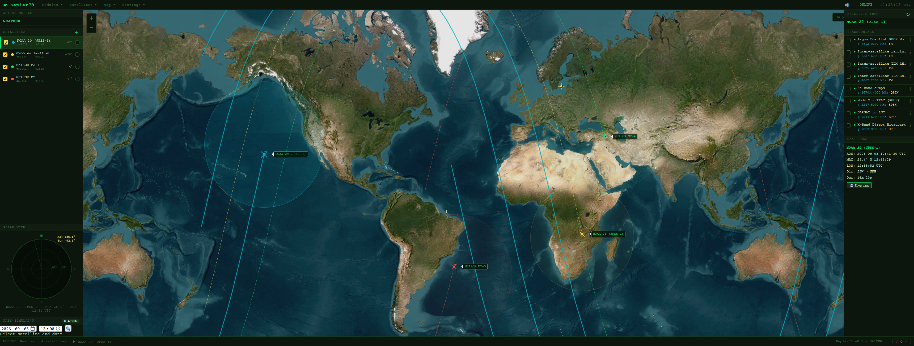

**Auto-track at work** — a NOAA pass is being tracked by itself: the status bar shows the running pass
and the Doppler-corrected frequency, the polar view shows the satellite (yellow, dashed) and where
the rotator really points (solid green strobe, ring and beam wedge), and the footprint follows the
real shape of the coverage area.

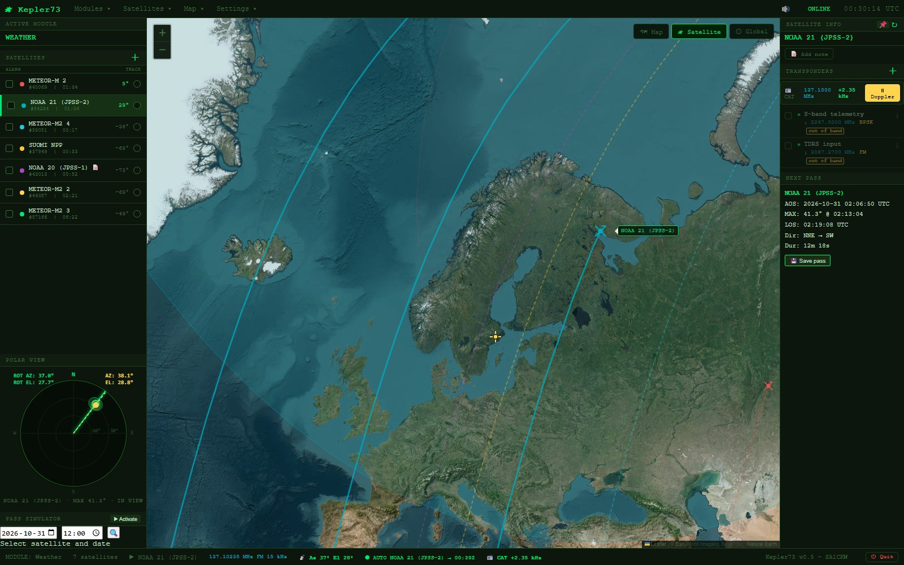

**Auto-track passes** — tick satellites from any module, a threshold per satellite, an optional
downlink for CAT, your own start / end commands, and a 24-hour preview that shows which passes will
be tracked and which are skipped (and why).

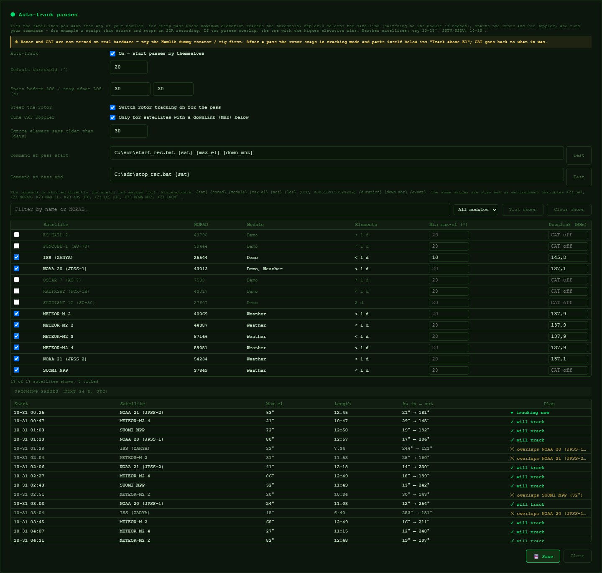

**Transponders, notes and CAT** — the panel pinned beside the map: a single selected transponder,
a `✎ manual` entry of your own, transponders outside the radio's bands greyed out, a note on the
satellite, and the CAT strip. The status bar shows the tuned frequency, mode and passband.

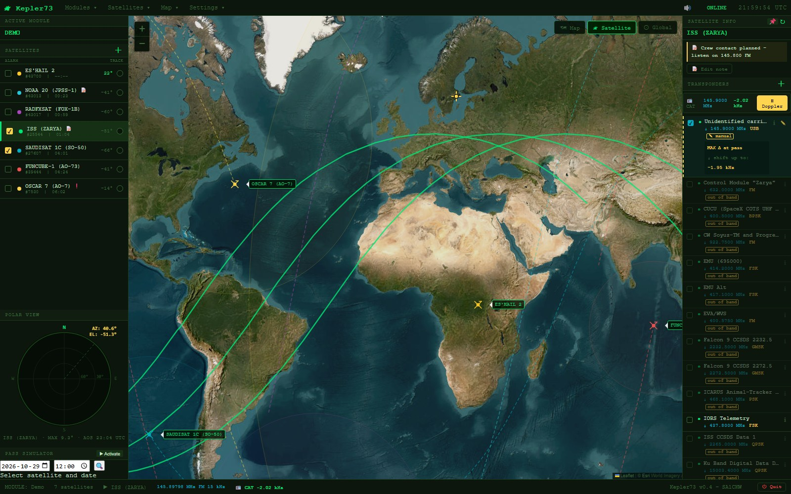

**Radio / CAT** — live link to `rigctld` (here Hamlib's dummy rig).

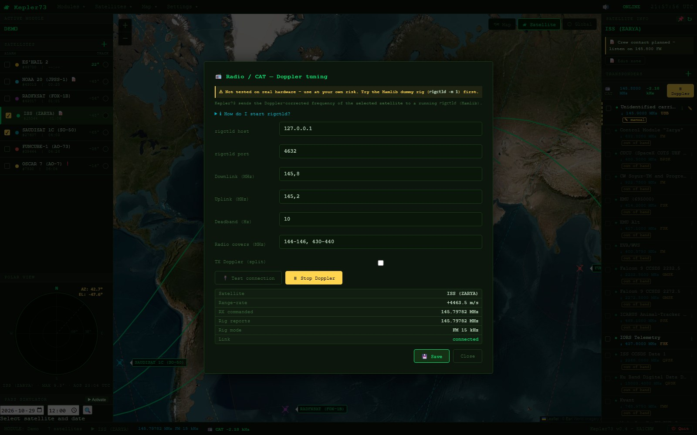

**Rotator** — tracking through `rotctld` (here Hamlib's dummy rotator), with Park and STOP, and
options for how the rotator is drawn in the polar view (antenna beamwidth, beam on/off).

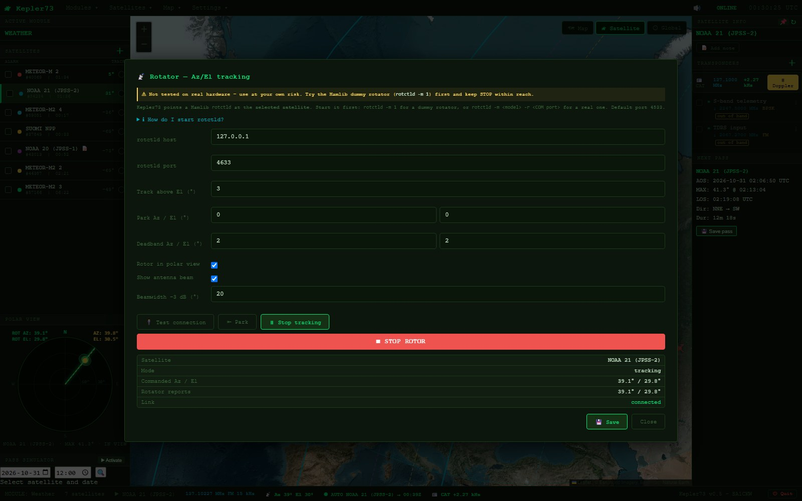

**TLE sources & offline station** — several sources, one per line, with a status line for each.

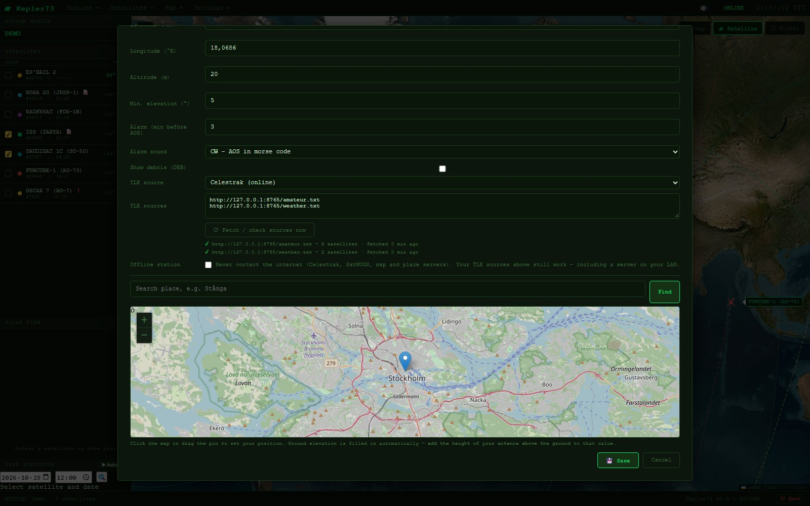

**Satellites menu** — auto-track, export / import your own transponders & notes, and the offline data pack.

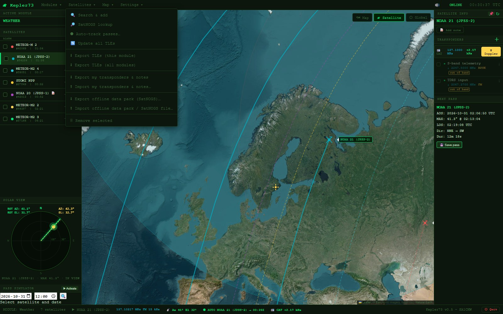

**About** — hardware warning and the update check.

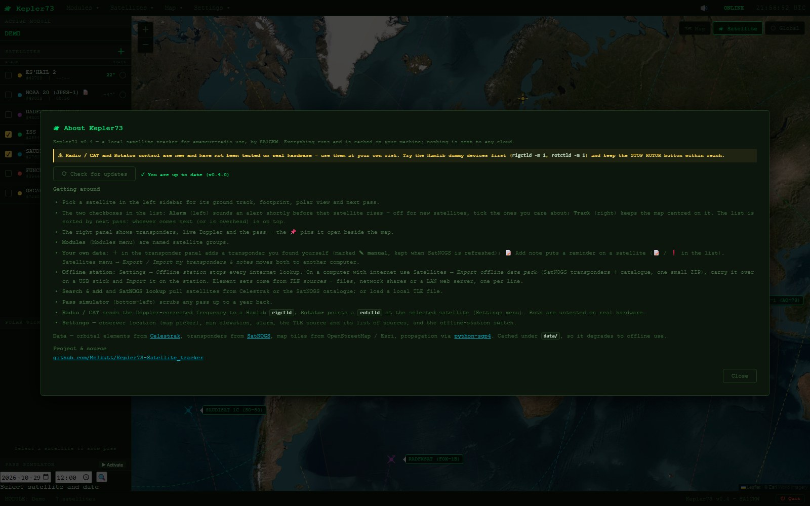

**SatNOGS lookup** — faceted filtering (modulation / service / type / country / frequency /
geostationary) over the whole SatNOGS catalogue, sortable columns, and satellite status. Here the
145–146 MHz downlinks with the highest NORAD IDs first: satellites that are *not launched* or have
*re-entered* are dimmed with ⊘; the ＋ button adds the others to the active module.

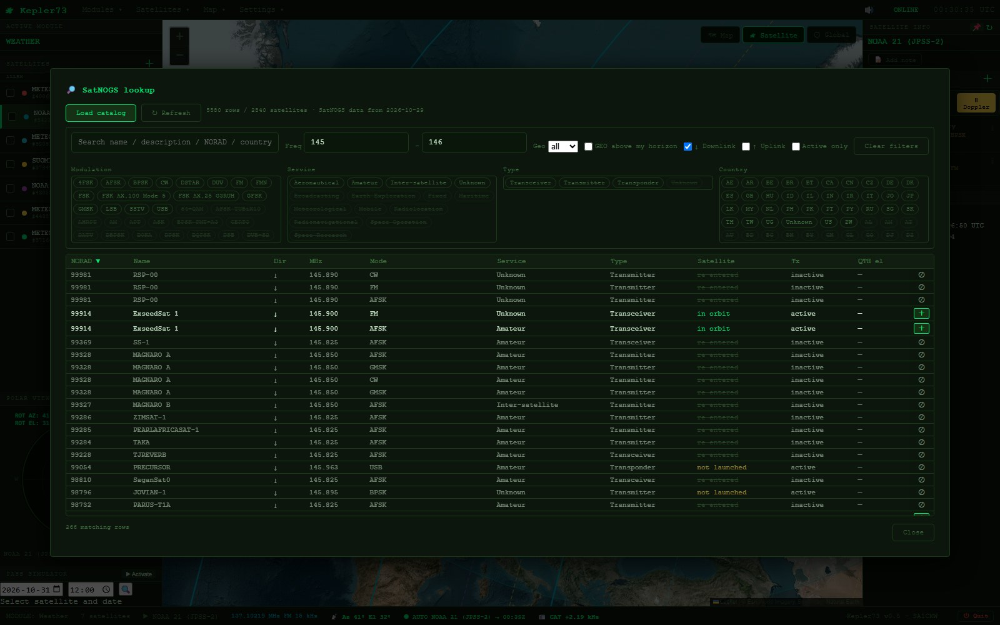

**Observer settings** — set your location by dragging the pin or searching a place name;
ground elevation is filled in automatically.

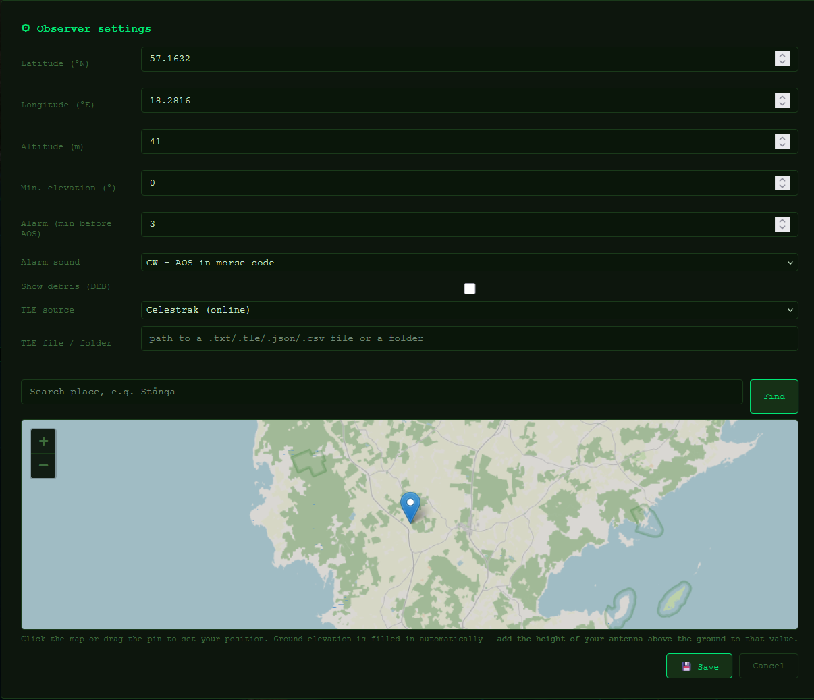

<sub>The screenshots were taken with demo data and Hamlib's dummy rig and rotator — not real hardware.</sub>

---

## Installation (Windows)

A pre-built Windows executable is available under [Releases](../../releases) — check the release
notes for the version it contains (**About** shows the version you are running).

1. Download `Kepler73.exe`
2. Double-click it
3. Your browser opens automatically at `http://127.0.0.1:5000`

No Python or any other software required. The exe keeps its data (config,
modules, caches) in `%USERPROFILE%\.kepler73`.

For radio or rotator control you also need [Hamlib](https://hamlib.github.io/) (`rigctld` /
`rotctld`) — see the dialogs under *Settings* for the one-line commands.

## Run from source

Any OS with Python **3.11+**:

```bash
git clone https://github.com/Melkutt/Kepler73-Satellite_tracker.git
cd Kepler73-Satellite_tracker
pip install -r requirements.txt
python main.py
```

The server starts on <http://127.0.0.1:5000> and opens your browser after ~1.5 s.
There is no build step for the frontend (plain HTML/CSS/vanilla JS).

## Build the Windows executable

```
pip install -r requirements.txt pyinstaller
build.bat            (or:  pyinstaller --clean --noconfirm kepler73.spec)
```

The single-file `dist\Kepler73.exe` is what goes on the Releases page.

---

## Notes

- **Single-user, localhost only.** It runs the Werkzeug development server — do not expose
  it to a network.
- Your observer location, modules, notes and all caches live under `data/`, which is git-ignored
  and never leaves your machine.
- Pass accuracy is only as good as the element set — a day-old LEO TLE is within ~1 s on
  pass times; anything weeks old drifts noticeably. Transponder data changes slowly (a yearly
  refresh is fine), element sets do not.
- Leaflet and the socket.io client are **bundled** (`frontend/vendor/`), so the page loads with no
  internet at all, and a **built-in world map** (land, lakes, borders) is always there. The
  detailed satellite / street tiles, however, only exist offline for the areas you have looked at
  before — browse your region once on a connected machine and copy the `data/tile_cache`
  folder (`%USERPROFILE%\.kepler73\tile_cache` for the exe) to the station.
- Hamlib daemons: `rigctld -m <model> -r <COM port>` — `-r` is the *radio's* serial port, the
  TCP port (4532 / 4533) is set with `-t`; `rigctld -l` lists the model numbers.

## Roadmap

- [x] Live satellite tracking
- [x] Pass prediction and simulator
- [x] Pass alarms
- [x] Polar view with real-time strobe
- [x] SatNOGS transponder data and lookup
- [x] Real-time Doppler correction
- [x] Offline / local-file TLE sources, several sources incl. LAN URLs
- [x] Bulk Celestrak catalogue (one request instead of one per satellite)
- [x] Your own transponders and notes, export / import
- [x] Offline station mode and SatNOGS data pack
- [x] CAT radio control (Hamlib `rigctld`) — receive Doppler **(untested on real hardware)**
- [x] Rotor control (Hamlib `rotctld`) — basic tracking **(untested on real hardware)**
- [ ] Test CAT and rotor on real hardware
- [ ] CAT: TX Doppler, split operation, PTT
- [ ] Rotor: pre-position before AOS, north-crossing / flip, direct EasyComm backend
- [x] Auto-track passes: pick satellites + elevation threshold, start/end commands for recording **(rotor / CAT parts untested on real hardware)**
- [x] Footprint drawn as the true great-circle outline
- [x] Leaflet and socket.io bundled locally (works with no internet at all)
- [x] Built-in offline world map (Natural Earth)
- [ ] Export / import of cached map tiles ("map pack") for detail on the offline station
- [ ] Auto-track: ready-made recording scripts for common SDR programs
- [ ] Telemetry decoding / waterfall (idea — via a companion tool and `rigctld`)
- [ ] macOS and Linux builds of the executable

---

## License

Public domain — [The Unlicense](LICENSE). Do what you like with it.

Bundled in `frontend/vendor/` under their own licences: [Leaflet](https://leafletjs.com) (BSD 2-Clause), the [Socket.IO client](https://socket.io) (MIT) and the [Natural Earth](https://www.naturalearthdata.com) base map (public domain).

TLE data courtesy of [Celestrak](https://celestrak.org). Transponder data courtesy of [SatNOGS](https://db.satnogs.org). Orbital mechanics via [python-sgp4](https://github.com/brandon-rhodes/python-sgp4).

---

*73 de SA1CKW*
